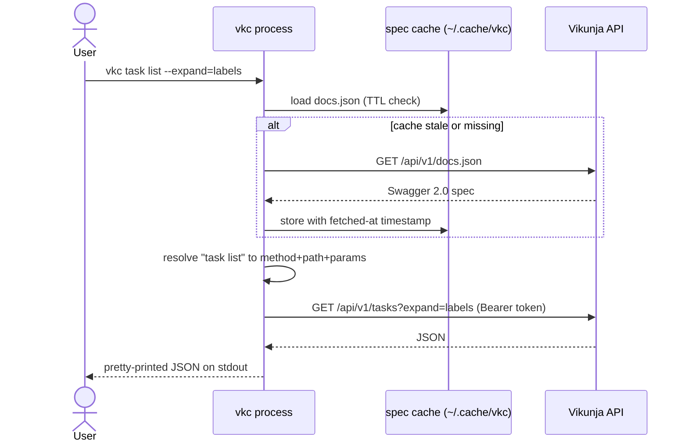

# Technical Architecture — vkc

vkc is a single Go binary. It has one container (the `vkc` process), no database, no server component, and talks to exactly one external system per invocation: the Vikunja API.

## C4 model

Level diagrams live in `technical-architecture/c4/`:

- `c4/context.md` — the user, vkc, and the Vikunja instance
- `c4/container.md` — the vkc binary and its runtime parts (spec cache, token store)
- `c4/component.md` — modules inside the binary
- `c4/deployment.md` — where users install and run it

## Tech stack

Summarized here, detailed in `technical-architecture/tech-stack.md`:

- **Go ≥ 1.27**, standard library first; the only anticipated third-party dependency is a CLI framework if command-tree ergonomics demand one (ADR-0001).
- **Spec access:** HTTP GET of `/api/v1/docs.json`, cached on disk with a TTL (`~/.cache/vkc/`).
- **Transport:** direct HTTPS to the Vikunja instance, Bearer token auth (ADR-0003).
- **Output:** JSON on stdout rendered by the caller's own `jq` by default (`--raw` for raw bytes); vkc adds no formatting layer beyond pretty-printing.

## Deployment topology

Single binary, installed by `go install`, `go build`, or a released artifact. There is no deployment surface beyond release distribution; see `technical-architecture/deployment.md` and ADR-0003.

## Key sequence: a normal command

