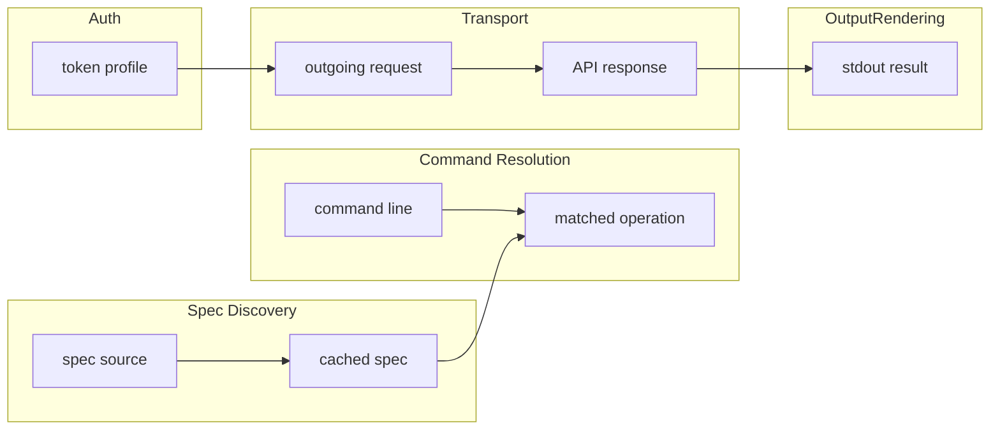

# Domain Model — L1 (prose glossary)

vkc's domain is small: it is a *translator* between an operator's command line and whatever API surface a Vikunja instance happens to expose. Five bounded contexts cover everything.

## Bounded contexts

- **Spec Discovery** — knows where an OpenAPI spec lives (`/api/v1/docs.json` on any instance), how to fetch it, and how to keep a fresh copy on disk without hammering the server.
- **Command Resolution** — the translator proper. Turns `vkc task list --expand=labels` into an HTTP method, path, query string, and body by matching two-level commands against spec operations. Command names are *derived*, not memorized.
- **Auth** — holds the operator's Vikunja token between sessions and attaches it to requests. The token has meaning only within one server profile.
- **Transport** — the messenger. Builds the actual HTTPS request, forwards user passthrough flags, receives responses, and never interprets them beyond status handling.
- **Output Rendering** — shapes what the operator sees: pretty JSON by default, raw bytes on `--raw`, and help screens assembled from spec descriptions.

## Business rules

1. Nothing about specific Vikunja endpoints may be written into vkc's source; only the spec describes the surface (ADR-0004).
2. The naming layer (spec text → command names) is a maintained heuristic: it must be right for the common case and wrong loudly, never silently.
3. A command that cannot be resolved from a *current* spec must fail with guidance (`vkc find`), not with a stale cached table.

## Word map (conceptual)

## Words to avoid

- Do not say "registry" for the derived command tree — the tree is recomputed from the spec, not registered.
- Do not say "the API" ambiguously: it always means the specific instance the profile points at, since instances can differ in version.
