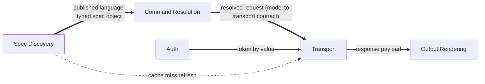

# Context Map

vkc's five bounded contexts are internal to one binary, so all relationships are in-process collaborations:

- **Spec Discovery → Command Resolution:** *upstream/open host* — the parsed spec object is the published language everything downstream reads.
- **Command Resolution → Transport:** *customer/supplier* — resolution supplies a fully-formed request model; transport consumes it without spec knowledge.
- **Auth → Transport:** partnership at call time; Auth is upstream for credentials only.
- **Transport → Output Rendering:** conformist — rendering accepts whatever JSON arrives.

The Vikunja spec itself is an *external upstream with published language* (the OpenAPI document) that Spec Discovery conforms to; Swagger-2.0 quirks are isolated inside Spec Discovery (an anticorruption layer against spec-format drift).
