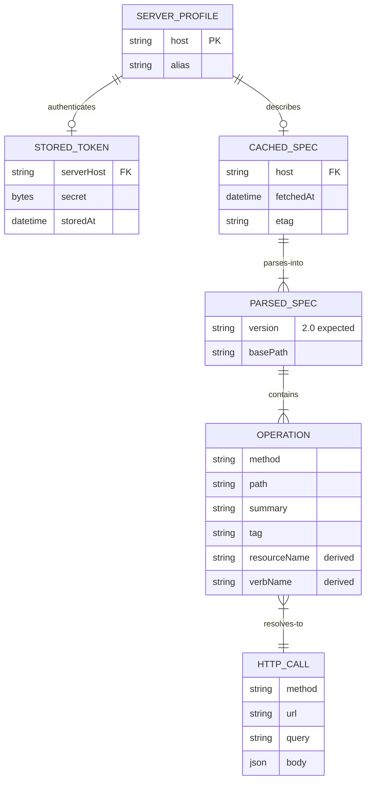

# Domain Model — L2

## Entities and value objects

## Ubiquitous language (developer layer)

| Term | Definition | Invariant |
|---|---|---|
| **Server profile** | a host + alias pair the operator logs into | exactly one token and one cache entry per profile |
| **Operation** | one method+path pair from the spec with its summary, tags, params, body schema | immutable once parsed |
| **Resource** | a grouping of operations derived from per-op tags or path segments | names must be plural, lowercase, collision-free |
| **Verb** | the second command level, derived from summary text or method semantics | every resource has ≥1 verb; ambiguous summaries fail loudly |
| **Passthrough** | everything after `--` or the first unknown flag, forwarded verbatim | never rewritten or dropped |
| **Escape hatch** | the `vkc raw METHOD /path` command shape | bypasses naming entirely; still goes through Auth and Transport |

## Aggregates

- **`ServerProfile` aggregate** — profile, its token, and its cached spec form one consistency unit: `vkc logout` must clear all three artifacts for that host.
- **`ParsedSpec` aggregate** — the immutable parsed result; command resolution never mutates it.

## Invariants

1. A `Command Resolution` decision may only reference operations from the `ParsedSpec` of the profile being addressed.
2. `Passthrough` bytes are unchanged between the user's argv and the outgoing request.
3. Help text must be traceable to spec content (description fields); hand-written help is a bug.
