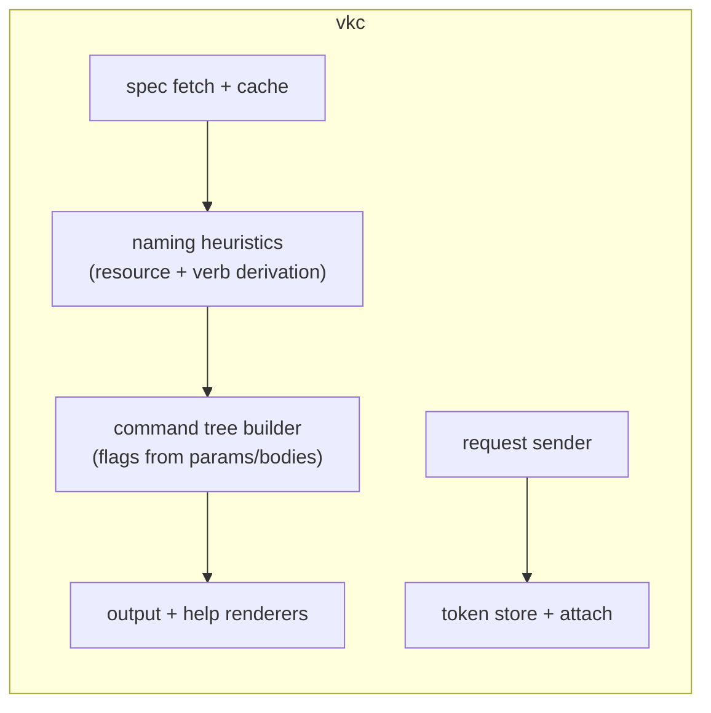

# C4: Components

Inside the single binary, the planned module structure:

| Component | Responsibility | Key constraint |
|---|---|---|
| spec | fetch, TTL-cache, parse Swagger 2.0 | normalize caveats to one module (ADR-0002) |
| naming | derive resource/verb names from path + summary | owner-maintained heuristics, fixture-tested (ADR-0004) |
| tree | build command tree, flags, completions | no knowledge of specific endpoints |
| auth | store/load/attach the Bearer token | keychain first; never log the token |
| transport | method+path+query/body assembly, timeouts | transparently forwards `--` passthrough |
| render | pretty JSON default, `--raw` mode | JSON out by default; help text from spec descriptions |

Testing strategy: components 1–3 get unit tests against spec fixtures; transport gets an httptest server; end-to-end smoke runs against a specified live instance.
