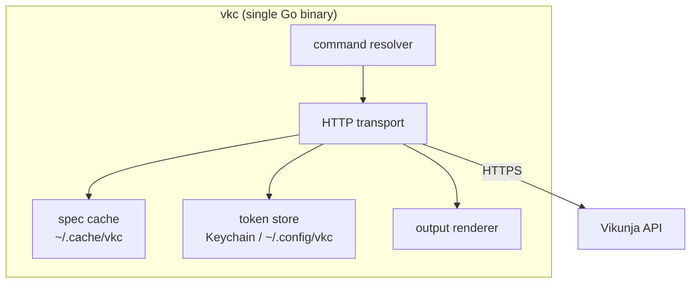

# C4: Containers

## Runtime containers

There is exactly one process: the `vkc` binary. Two on-disk stores (spec cache, token store) are containers in C4 terms because they outlive the process and hold state users can inspect or break. The cache is disposable (safe to delete); the token store is sensitive (chmod 600 file fallback, keychain preferred).
