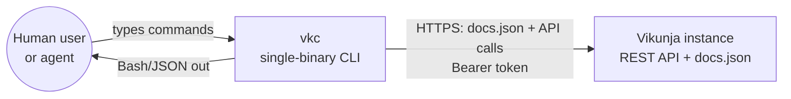

# C4: System Context

## Actors and systems

- **User** — a human or a coding agent orchestrating Vikunja from a terminal.
- **vkc** — the system under design; discovers its own command surface from the spec instead of embedding it (ADR-0004).
- **Vikunja instance** — external system of record; every instance serves its own spec, so vkc works against any instance it is pointed at.

Trust boundary: the bearer token crosses to Vikunja on every API call; the spec fetch is an unauthenticated, read-only GET.
